

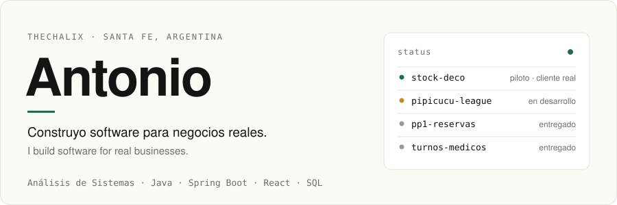

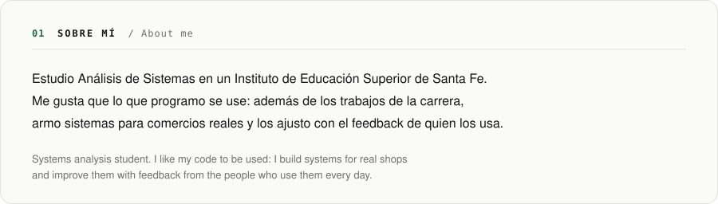

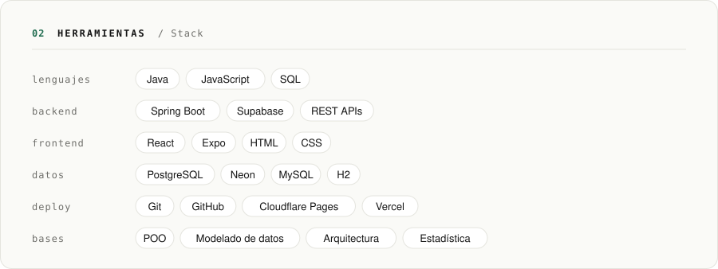

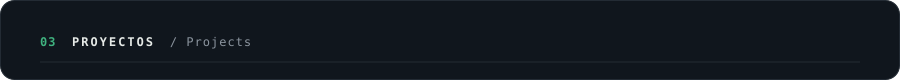

<a href="https://github.com/TheChaliX/stock-deco">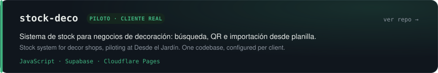</a>

<a href="https://github.com/TheChaliX/PP1-2026-grupo1">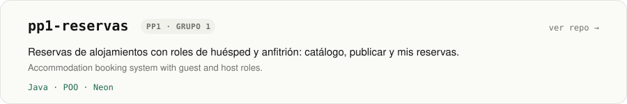</a>

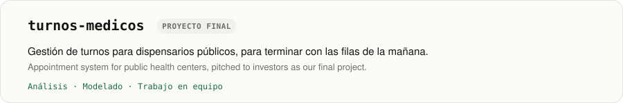

<a href="https://github.com/TheChaliX/ies9233-isw2-gN3-frontend">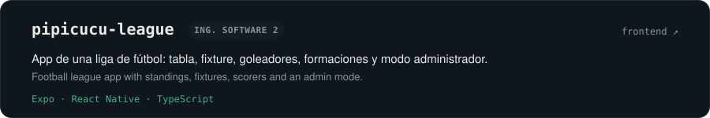</a>

<a href="https://github.com/TheChaliX/ies9233-prog1-gN3-backend">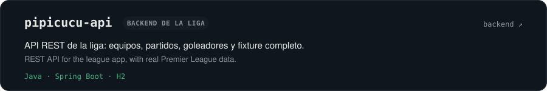</a>

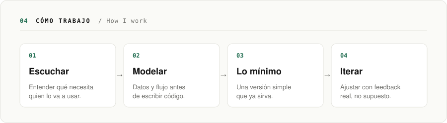

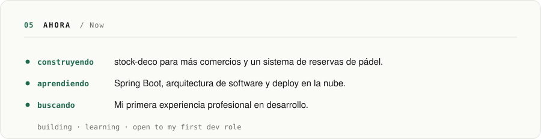

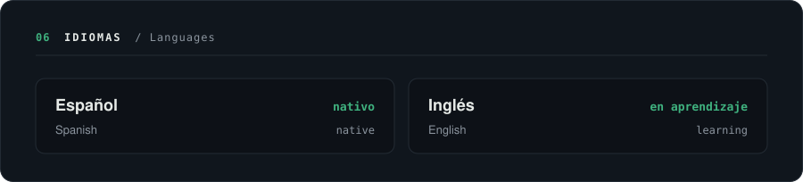

<a href="https://github.com/TheChaliX?tab=repositories">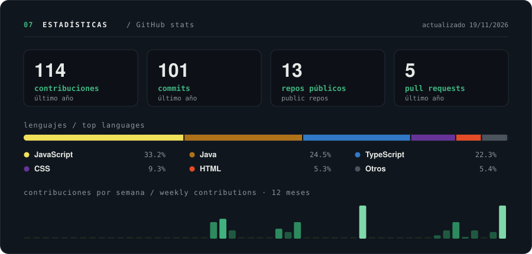</a>

<a href="mailto:antochalita65@gmail.com">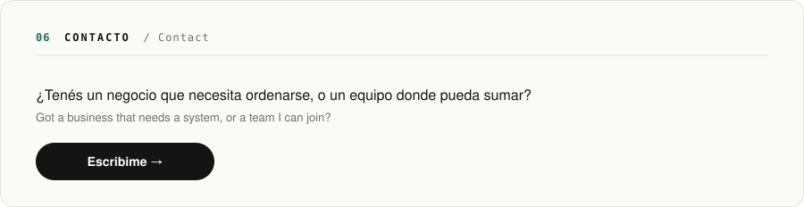</a>

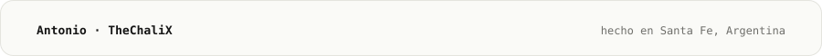

