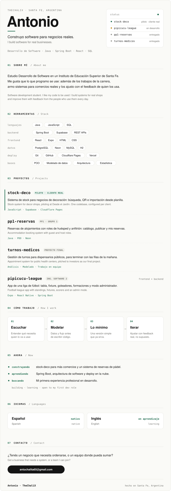

  

<a href="https://github.com/TheChaliX/stock-deco">stock-deco</a> ·
<a href="https://github.com/TheChaliX/PP1-2026-grupo1">pp1-reservas</a> ·
<a href="https://github.com/TheChaliX/ies9233-isw2-gN3-frontend">liga frontend</a> ·
<a href="https://github.com/TheChaliX/ies9233-prog1-gN3-backend">liga backend</a> ·
<a href="mailto:antochalita65@gmail.com">antochalita65@gmail.com</a>

